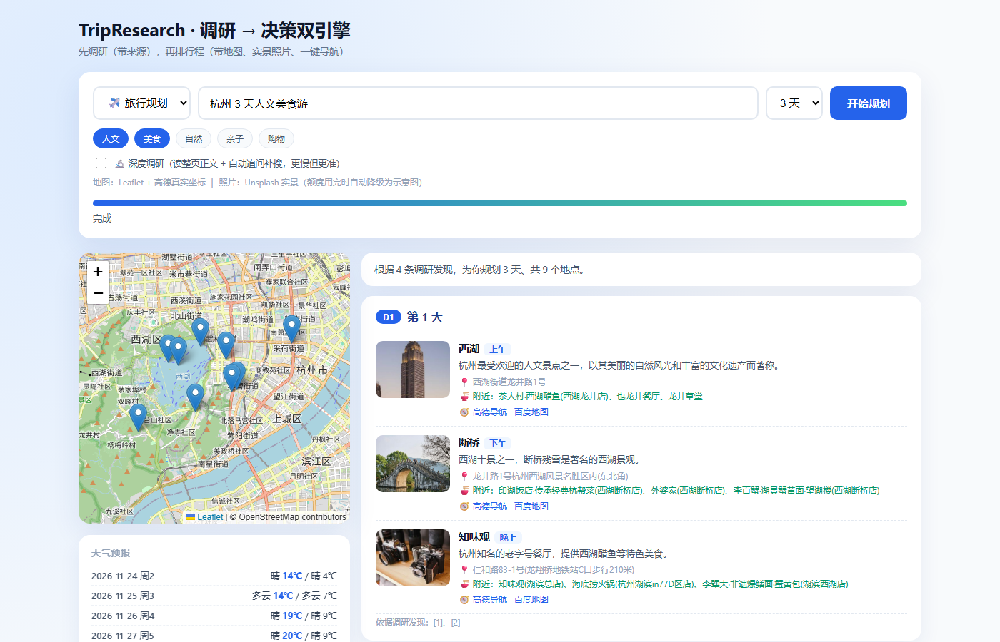
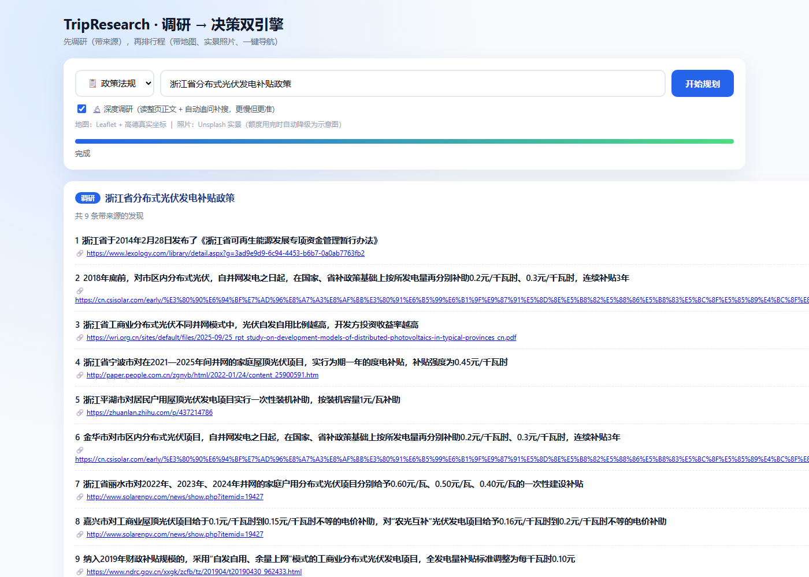
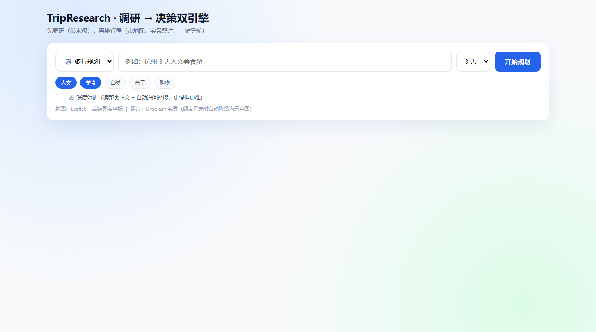

# TripResearch · 调研 → 决策双引擎 Agent

> 输入一个主题，先做**带来源的调研**，再基于证据做**决策**（如生成旅行行程）。
> 调研引擎是独立的通用组件，可切换领域：旅行 / 政策 / 电商 / 通用。

[](https://www.python.org/)
[](https://fastapi.tiangolo.com/)
[](https://github.com/AJ-zj/deep_search/actions/workflows/ci.yml)
[](LICENSE)

---

## 效果预览

**旅行规划**：左侧地图（真实坐标 + 打点）、天气预报；右侧逐日行程，每个地点带实景图、地址、附近美食、导航链接。



**政策调研**（深度档）：每条结论都带来源链接，可逐条核对。



**入口**：领域可切换、深度可开关。



---

## 它解决什么问题

直接用大模型生成方案，最大的问题是**没有依据**——"推荐去西湖"这类话谁都会说，
但你无法核实它是否真实、是否过时。

本项目把流程拆成两步：

1. **调研**：把主题拆成若干子问题 → 联网搜索 → 提炼成**每条都带来源 URL** 的发现
2. **决策**：**只依据这些发现**生成方案，并标注每条依据的是哪条调研结果

于是产出的方案可以**逐条溯源**：页面上的每个安排都能点开原始网页核对。

```
用户输入主题
   │
   ├─ ① 调研引擎 ── 拆问题 → 搜索 → 提炼 → KnowledgePack（带来源）
   │
   └─ ② 决策引擎 ── 消费 KnowledgePack → 生成方案（标注引用编号）
```

## 两种调研深度

| 档位 | 读什么 | 是否追问 | 耗时 |
|---|---|---|---|
| 快速（默认） | 搜索摘要 | 否，固定 3 轮 | ~16s |
| 深度 | **整页正文** | **是**，发现证据缺口自动补搜 1-2 轮 | ~18-30s |

深度档会读取网页全文（而非摘要），并让 LLM 充当"审校员"判断还缺什么信息，
不足则自动追问再搜一轮。实测同一政策主题：快速档只得到笼统结论，
深度档能拿到具体数字（补贴标准、文号、适用期限）。

## 质量评测（不只是"能跑"，而是"跑得准"）

调研最容易做成自嗨：能输出一堆结论，但没人知道准不准。
所以配了一套评测：`tests/eval_set.json` 是人工核实的标准答案，
`tests/eval_policy.py` 自动打分。

**实测结果**（10 个真实政策主题 × 每个跑 3 次取均值，标准答案以政府公开文件为准）：

| 指标 | 纯 RAG | +图谱（推荐配置） |
|---|---|---|
| 内容准确率（总体） | 97% | **98%** |
| 国家分布式光伏（多跳痛点） | 67%（波动 25~100） | **92%**（75~100） |
| 全国碳排放权（多跳痛点） | 83%（波动 50~100） | **100%（波动消除）** |
| 政策卡片字段完整度 | 3.2/6 | **4.3/6** |
| 权威来源占比（S/A 级） | 55% | 58% |
| 低质来源条数 | **0** | **0** |
| 反向用例（虚构主题防编造） | 3/3 通过 | 3/3 通过 |
| 平均耗时 | 18s | 18s（图查询纯本地，零额外调用） |

**两个用例存在波动**，如实列出：
- 国家分布式光伏：50%~100%（偶尔没搜到具体文号）
- 全国碳排放权交易：50%~100%（偶尔漏掉发布主体）

> 单次运行噪声较大，所以默认要跑 `--repeat 3`。早期用 3 个精选用例曾测出 92%，
> 扩到 10 个主题后才是现在这个更可信的数字。

怎么跑：

```bash
python tests/eval_policy.py                    # 快速档（单次）
python tests/eval_policy.py --repeat 3         # 重复 3 次取均值（推荐）
python tests/eval_policy.py --deep             # 深度档
python tests/eval_policy.py --out report.md    # 输出 Markdown 报告
```

**评测暴露并修掉的真问题**：

1. **语义漂移**：深度档读整页正文时，正文里混着无关政策，
   模型把《关于全面推进政务公开工作的意见》当成了光伏政策。
   → 修复：提炼时注入主题约束，明确"资料讲的是别的话题就不要提炼"。
   深度档准确率从 83% → 92%。

2. **来源等权**：原来政府红头文件和营销号一视同仁。
   → 修复：按域名分级 S/A/B/C/D，D 级直接剔除，其余按权威性排序。
   现在低质来源 = 0 条。

3. **虚构主题被编造**：问"火星基地建设补贴政策"，模型会把随机搜到的
   家电补贴包装成答案。
   → 修复：搜索结果先做相关性预检（提取 2-3 字实体词，排除"补贴/建设"等通用词），
   完全不沾边就判定无相关内容，不提炼。反向用例 3/3 通过。

**诚实的局限**：
- 单次评测波动大，必须 `--repeat 3` 才稳定，否则数字会忽高忽低
- 关键词命中是简化判定，不理解语义等价表达
- 未评估"完整性"——漏掉重要信息不扣分
- 权威来源占比只有 55%，说明仍有一半来源是类专业媒体/一般网站

---

## GraphRAG（迷你版）

纯 RAG 的天花板在多跳关系：搜索结果是一段段独立摘要，串不起
"《暂行条例》→依据→《试行办法》→由国务院发布"这类政策演化链。
评测里两个用例因此长期波动（50%~100%）。项目加了一条 GraphRAG 旁路：

```
离线编译（一次性）                        在线查询（便宜）
build_corpus.py        extract_triples.py        graph_query.py
搜索主题 → 收全文      LLM 抽三元组              问题 → 实体定位
50 篇 / 20.2 万字  →   445 实体 / 302 关系   →    → 2 跳 BFS
(文档级相关性过滤)     (受控关系词表9种)          → 注入政策卡片构建
```

三个命令即可重建全链路（生成物不入库，语料可重新抓取）：

```bash
python graph/build_corpus.py      # 固化政策语料库（约 27 次搜索）
python graph/extract_triples.py   # 逐篇抽三元组建图（约 50 次 LLM）
python graph/graph_query.py "碳排放权交易管理办法的发布主体是谁"
```

接入点在 `pipeline.py` 的 policy 分支：图谱上下文与调研发现一起喂给
卡片抽取，冲突时图谱优先（来自全文精读，比搜索片段可信）。
**图谱不存在时自动回退纯 RAG**——没跑过编译链路的人不受任何影响。

关键设计决策：

| 决策 | 理由 |
|---|---|
| 关系受控词表（9 种） | 自由发挥会得到上千种同义关系名，图即报废 |
| NetworkX 级 JSON 起步 | 50 篇语料内存图绰绰有余；Neo4j 只是将来换的持久层 |
| 文档级两级过滤 | 招聘启事曾混进语料被抽 14 条三元组；但一刀切"严格过滤"又误杀了"杭州市十四五规划"（相对"浙江省规划政策"主题只命中 1 词）。定版：写入从严（≥2 实体词），入图从宽（只排 0 命中） |
| 主题归属过滤 restrict_topic | "分布式光伏"是全国同名词，2 跳链曾把国家 761 号文流进浙江主题的卡片。三元组带 docs 溯源，跨主题关系不注入 |

**效果**（同评测集对比，详见下节）：多跳痛点用例"全国碳排"从 83%（50~100 波动）
到 **100%（波动消除）**；卡片字段完整度 3.2/6 → 4.3/6；低质来源保持 0。

---

## 调研引擎是通用组件

引擎逻辑只有一份，"怎么拆问题、怎么过滤"由领域配置决定，
见 [`core/domain.py`](core/domain.py)。换配置即换业务，代码不用改。

| 领域 | key | 拆解维度 |
|---|---|---|
| 旅行规划 | `travel` | 景点口碑 / 特色美食 / 行程节奏与避坑 |
| 政策法规 | `policy` | 政策文件与主体 / 适用范围 / 关键数字 / 有效期 |
| 电商内容 | `ecommerce` | 人群痛点 / 竞品卖点 / 真实评价 / 平台合规 |
| 通用调研 | `general` | 概念背景 / 现状事实 / 案例数据 / 趋势风险 |

```python
from core.llm import LLM
from core.tools import SearchTool
from agents.researcher import ResearchEngine

engine = ResearchEngine(
    LLM(model="Qwen/Qwen2.5-32B-Instruct", api_key="...", base_url="..."),
    SearchTool(api_key="tvly-..."),
)

# 同一个引擎，四种用途
pack = engine.research("杭州 3 天人文美食游", domain="travel")
pack = engine.research("浙江省分布式光伏补贴政策", domain="policy", deep=True)
pack = engine.research("抖音鞋类带货文案卖点", domain="ecommerce")

for f in pack.findings:
    print(f.claim, "←", f.source)
```

## 快速开始

> 换设备部署、key 申请、常见问题见 [SETUP.md](SETUP.md)

```bash
git clone <this-repo>
cd TripResearch

python -m venv .venv
# Windows
.venv\Scripts\activate
# macOS / Linux
source .venv/bin/activate

pip install -r requirements.txt
cp .env.example .env      # 然后填入 API Key
python api/main.py        # 打开 http://127.0.0.1:8003
```

最少只需要配置 `OPENAI_API_KEY`（任意 OpenAI 兼容接口）。
强烈建议再配 `TAVILY_API_KEY`，否则搜索会降级到内置示例资料。

## 接口

```http
POST /api/plan/stream
Content-Type: application/json

{
  "topic": "杭州 3 天人文美食游",
  "days": 3,
  "interests": ["人文", "美食"],
  "domain": "travel",
  "deep": false
}
```

响应是 SSE 流，逐条推送进度与最终结果：

```
data: {"type":"progress","percentage":15,"text":"正在调研：..."}
data: {"type":"status","text":"正在调研 1/3：..."}
data: {"type":"report","data":"<Markdown 报告>","plan":{...},"pack":{...}}
data: {"type":"done"}
```

其他接口：

- `GET /api/domains` — 列出可用领域
- `GET /health` — 健康检查

## 项目结构

```
TripResearch/
├── core/                 共享内核（两个引擎都用）
│   ├── llm.py            LLM 客户端（流式 / 禁代理 / UTF-8 / 退避重试）
│   ├── config.py         配置（.env + 环境变量）
│   ├── tools.py          搜索工具（Tavily，支持全文抓取与清洗）
│   ├── evidence.py       证据契约（Finding / KnowledgePack / 方案数据结构）
│   ├── domain.py         领域配置（通用组件的关键）
│   ├── amap.py           高德：坐标 / 周边 / 天气
│   └── photos.py         图片（Unsplash + 缓存 + 兜底）
├── agents/
│   ├── researcher.py     调研引擎（可配置领域、可选深度）
│   └── planner.py        决策引擎（知识包 → 结构化方案）
├── pipeline.py           编排层（串起两个引擎）
├── api/
│   ├── main.py           FastAPI + SSE
│   └── static/index.html 单页界面（原生 JS，零构建）
└── tests/                分步测试
```

## 设计取舍

- **不用 Agent 框架**：整条链是确定的流程（拆解→搜索→提炼→生成），
  用一个轻量 Agent 循环即可，引入重型框架反而增加调试成本。
- **LLM 客户端自己写**：基于 `requests`，禁用系统代理、流式读取、
  手动 UTF-8 解码、指数退避。兼容 OpenAI 风格响应结构。
- **证据契约先行**：`KnowledgePack` 是调研与决策之间唯一的接口，
  保证下游只能用"已读取的证据"，不允许凭空生成。
- **防御脏数据**：LLM 输出的 JSON 会带代码块围栏、尾逗号、字段别名；
  搜索结果可能跑题（实测搜杭州美食返回日本料理）。都做了容错与过滤。

## 已知限制

- 搜索结果质量依赖搜索 API，域名权威性未做排序加权
- 决策（排行程）只实现了旅行场景；其他领域只产出调研发现
- 未做用户体系与持久化，`workspace/` 仅缓存图片 URL
- 深度档成本高于快速档（约 2 倍），并发高时建议用快速档

## License

MIT
